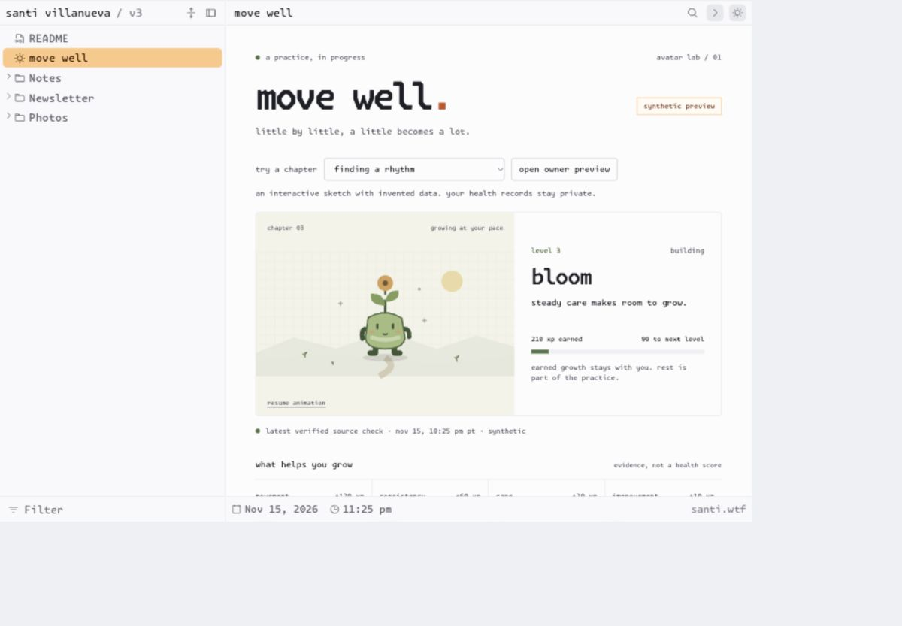

# move well / avatar lab



## working milestone

`move-well.njk` adds an avatar to the existing eleventy shell, sidebar, and command palette. the companion breathes, blinks, and visibly changes from seed to sprout, bloom and canopy. animation can be paused and respects reduced motion. six synthetic scenarios demonstrate a beginning, steady practice, rest, injury, stale data and missing data. no external services or new frontend dependencies are required.

`public/js/move-well-model.js` is the shared, pure rules engine. the public browser evaluates synthetic evidence only. an independent private adapter can use the same engine and deliver a versioned, derived owner projection to the local preview server. neither the build nor github actions reads private files or health sources.

## rules v1

defaults: 10 xp per verified movement day; 5 consistency xp per movement day, limited to three days per monday-based local week; 5 xp per explicitly confirmed recovery action; 10 xp per explicitly verified personal milestone. distance, intensity, speed, sleep duration and hrv do not change points. activity is capped once per day across domains and duplicate evidence is merged. automatic sleep imports never count as a recovery action.

in rest/injury mode, explicitly confirmed intentional rest days can earn the same consistency credit. absent records never imply rest, inactivity, or failure. there are no streak penalties or xp decay. the private adapter retains the highest earned xp so rolling windows and corrections cannot erase earned growth; pillar totals describe only current evidence. rule recalibration can change calculated levels and should be reviewed deliberately.

100 xp advances a level by default. seed starts at level 1, sprout at 2, bloom at 3 and canopy at 5. all six rule values are adjustable in the synthetic preview. these adjustments do not save or alter owner settings. private rest/injury mode, care dates, milestones and rule settings belong in the private integration.

## data contract

`evaluateEvidence(input, rules, now)` accepts schema version 1, `synthetic` or `private` audience, generation/verification timestamps, america/los_angeles local calendar dates, an explicit mode, daily verified evidence, source states and retained xp. supported source domains are running, recovery, strength, mobility and nutrition. adding a domain requires an explicit schema change and privacy review. unconnected domains remain planned; unknown days remain unknown.

the output contains only version/audience, dates, mode, derived xp/level/stage, pillar counts, a derived evidence calendar, source verification states, and rules. the preview endpoint validates every allowed field and rejects extras. future verification timestamps, impossible dates, invalid rules and unsupported evidence are rejected by the engine. no source-native identifiers or raw magnitudes belong in this projection.

freshness uses source verification time, not page generation time or last workout date. checks older than 36 hours are overdue; no verification is unknown. each source is evaluated separately. a checked source may have no recent activity. missing input never earns points, and prior earned growth can remain while sources are unavailable.

## preview and verification

```sh
npm ci
npm test
npm run build
npm run preview:move-well
```

open the printed local `/move-well/` url. the server binds only to loopback. an owner can supply `--private-file /absolute/path/outside/this/repository/avatar.json` after running their private projection bridge. click `open owner preview` to load it. no private data is fetched on public hosts, on initial load, or in the build. the server rejects cross-origin private requests, unexpected fields, and private files inside this repository; responses use no-store. no coach endpoint exists. do not place the private file in `public/`, `_site/`, a repo, or a hosted preview. stop the local server when finished.

the separate private project owns sheet access, provenance validation, the sole eligible long_sleep policy, protected manual values/formulas, summaries for the coach, and retained achievements. this repository owns only the presentation, rules contract and local projection boundary. private processing files remain in that private workspace, outside git. run its own synthetic tests before changing it.

## planned

strength, mobility and nutrition adapters; authenticated remote owner access; automatic projection refresh after the existing daily sync; and any personal public avatar projection are future work. the existing private dashboard provides strength-schema ideas, but its raw data and static data-fetch pattern are deliberately not reused. public real-data publishing requires explicit approval of exact fields and a separate publishing path. the current daily schedule is unchanged.
